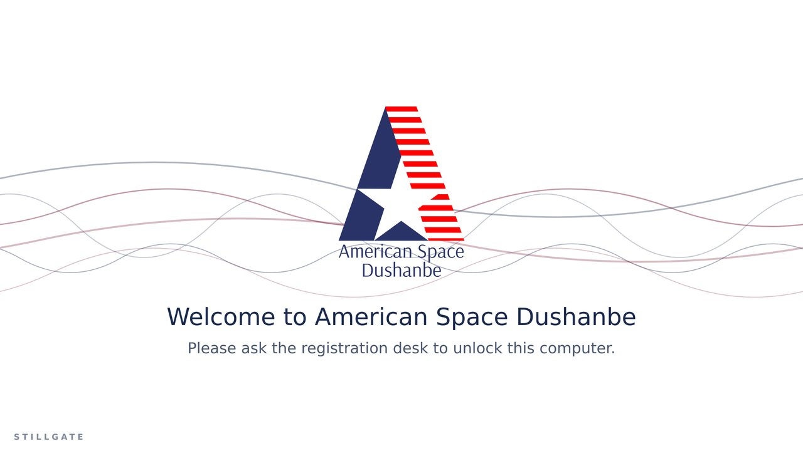
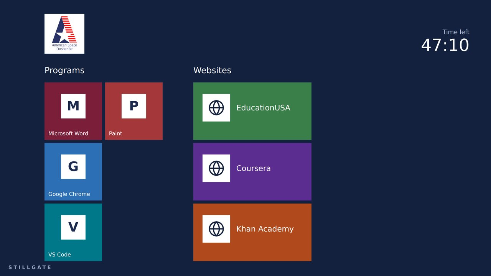
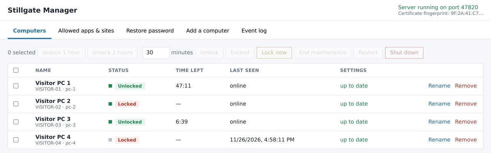

# Stillgate

**Stillgate** is lockdown software for shared visitor computers, built first for **American Space Dushanbe**.
A visitor PC boots straight into a locked screen. The registration desk unlocks it for a set time from a manager app; the visitor sees only the allowed programs and websites; when time is up, the programs close and the PC locks again.

- 4 visitor PCs (Windows 11 Home) + 1 manager PC, on one local network. No internet service, no cloud.
- If the manager is offline, PCs **stay locked**. Nothing unlocks without the manager.
- A maintenance hotkey (**Space + B + Y + S**) plus the restore password gives the normal Windows desktop back, even offline.

| Locked: waiting for the desk | Unlocked: only the allowed programs and sites, with a countdown |
|---|---|
|  |  |



<sub>Screens rendered from the built UIs with demo data. I built Stillgate as a volunteer for American Space Dushanbe.</sub>

**Stack:** TypeScript · Bun workspaces · Electron + React (kiosk and manager UIs) · a Windows service running as SYSTEM · TLS between manager and PCs with certificate pinning · zod-validated messages · scrypt-hashed restore password.

> ⚠️ **Status: built and tested on Linux and on a Windows 11 dev PC (full chain in dry-run); NOT yet tested as an installed service on a visitor PC.** See [`docs/TEST-DAY.md`](docs/TEST-DAY.md).
> Everything that touches Windows (registry, shell switching, process closing, restarts, services, installers) is marked `UNTESTED(windows)` and listed in [`TESTING.md`](TESTING.md). Safe defaults are on: **dry-run** (Windows changes are only logged) and **audit** (nothing is closed).

## The four parts
| Package | Runs on | What it is |
|---|---|---|
| [`packages/shared`](packages/shared) | (library) | Message formats, state machine, password hashing, allow-list rules, shared by everyone |
| [`packages/agent-service`](packages/agent-service) | each visitor PC, as SYSTEM | The guard: lock state, timer, enforcement, talks to the manager |
| [`packages/kiosk-shell`](packages/kiosk-shell) | each visitor PC, as the kiosk user | The screen visitors see (replaces the Windows desktop) |
| [`packages/manager`](packages/manager) | the manager PC | Desktop app: the server the PCs connect to, plus the manager UI |

## Quick start (development)
```bash
bun install          # install all dependencies
bun run build        # compile everything (+ both UIs)
bun run test         # 118 Bun tests + 11 Node tests (incl. end-to-end manager <-> agent)
bun run typecheck    # also type-checks the tests and both React UIs
```

## Documentation
- **Install it:** [`docs/INSTALL.md`](docs/INSTALL.md), manager PC + every visitor PC, step by step.
- **Learn how it works:** [`docs/learn/`](docs/learn/00-index.md), one simple explanation per part.
- [`docs/ARCHITECTURE.md`](docs/ARCHITECTURE.md): diagrams and how the parts talk.
- [`docs/DECISIONS.md`](docs/DECISIONS.md): every important decision and why.
- [`docs/SECURITY.md`](docs/SECURITY.md): what is protected and what is **not**.
- [`docs/RECOVERY.md`](docs/RECOVERY.md): how to un-stick a visitor PC.
- [`SETUP.md`](SETUP.md): building and installing on the real PCs.
- [`TESTING.md`](TESTING.md): the real-hardware test checklist.
